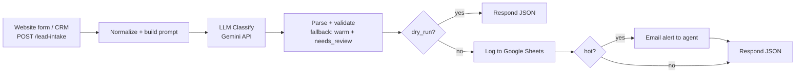

# AI Lead Qualifier — n8n Real Estate Automation

An [n8n](https://n8n.io) workflow that takes inbound real-estate enquiries from a webhook, classifies each one as **hot / warm / cold** with an LLM (Google Gemini), logs it to **Google Sheets**, and emails an alert to the sales agent for **hot** leads, so high-intent enquiries are not buried in an inbox.

The repo also ships a **labeled test set and an evaluation script**, so the claims below are measured and reproducible, not asserted.



## Features

- **Webhook intake** — any form, chatbot or CRM can `POST` a lead as JSON.
- **LLM classification** with a written rubric, temperature 0, and JSON-only output.
- **Safe failure** — if the LLM errors, times out or returns bad JSON, the lead is logged as `warm` with `needs_review = true` (3 retries first) instead of being dropped.
- **Google Sheets log** of every lead: intent, score, reason, latency.
- **Email alert for hot leads** via SMTP.
- **Dry-run mode** (`?dry_run=true`) classifies without writing to Sheets or sending email, used by the evaluation script.

## Tech stack

n8n (self-hosted Community Edition) · Google Gemini API (REST) · Google Sheets · SMTP · Python 3 (evaluation script, standard library only)

## Repository layout

```
workflows/lead_qualifier.json   # import this into n8n
data/leads_labeled.csv          # 45 synthetic labeled leads (15 hot / 15 warm / 15 cold)
data/build_dataset.py           # regenerates the CSV; add your own cases here
eval/evaluate.py                # accuracy, per-class metrics, confusion matrix, latency
eval/baseline_rules.py          # keyword-rule baseline the LLM must beat
eval/mock_llm.py                # fake Gemini endpoint for testing the wiring (not for accuracy)
results/                        # saved metrics (baseline.json is committed)
docs/                           # sample payload and Google Sheet header row
```

## Setup

1. **Run n8n locally** (Node.js LTS installed):
   ```bash
   npx n8n
   ```
   Open http://localhost:5678 or http://localhost:5678/home/workflows directly. The self-hosted Community Edition is free for personal/internal use.
2. **Import the workflow:** *Workflows → Import from file →* `workflows/lead_qualifier.json`.
3. **Create credentials** in n8n and attach them to the nodes:
   - **Gemini:** *Header Auth*, name `x-goog-api-key`, value = your key from [Google AI Studio](https://aistudio.google.com/). Attach to **LLM Classify**.
   - **Google Sheets:** OAuth2. Attach to **Log to Google Sheets**.
   - **SMTP:** attach to **Email Alert**, and set `fromEmail` / `toEmail` in that node.
4. **Create the Google Sheet:** a tab named `Leads` whose first row is the header in `docs/sheet_header.csv`. Paste the sheet ID into the **Log to Google Sheets** node.
5. **Model name:** the model is set in the **Normalize** node (`model`). If Google retires it, change that one line.
6. **Activate** the workflow, then send a lead:
   ```bash
   curl -X POST http://localhost:5678/webhook/lead-intake \
     -H "Content-Type: application/json" \
     -d @docs/sample_lead.json
   ```
   Response:
   ```json
   {"lead_id":"L-1001","intent":"hot","score":90,"reason":"...","needs_review":false,"latency_ms":1200}
   ```
   (The values above are only an example of the response shape.)

## Classification rubric

| Label | Meaning |
|---|---|
| **hot** | Clear intent to buy/rent within about 30 days **and** a concrete signal: stated budget, a specific property or locality, a visit or call request, loan or deposit ready |
| **warm** | Genuine interest but no firm timeline or budget, still comparing, or asking for information |
| **cold** | No real purchase intent: browsing, timeline longer than about 6 months, spam, vendor pitch, job enquiry, wrong number, unrelated |

## Evaluation

**Data:** 45 hand-written, **synthetic** leads (fake names, `example.com` emails), balanced 15/15/15, in `data/leads_labeled.csv`. Includes hard cases: a hot lead with no obvious keywords, a cold lead that mentions "buy" ("I already bought a flat last year"), and a third-party enquiry with no urgency.

**Metrics:** accuracy, macro-F1, per-class precision/recall, confusion matrix, and end-to-end latency. **Hot recall** is the one that matters most to the business, because a missed hot lead is a missed sale.

**Run it:**
```bash
python eval/evaluate.py --baseline                       # offline keyword-rule baseline
python eval/evaluate.py --url http://localhost:5678/webhook/lead-intake --delay 4   # the n8n + Gemini workflow
```
The script calls the workflow with `?dry_run=true`, so no Sheets rows or emails are produced. `--delay` avoids free-tier rate limits.

### Results

| Method | n | Accuracy | Macro-F1 | Hot recall | Hot precision | Median latency |
|---|---|---|---|---|---|---|
| Keyword-rule baseline | 45 | 84.4% | 0.85 | 73.3% (11/15) | 100% | n/a |
| **n8n + Gemini workflow** | 45 | `TBD` | `TBD` | `TBD` | `TBD` | `TBD` |

> **Fill in the Gemini row from your own run before publishing.** Copy the table line that `evaluate.py` prints, and delete this note.

Baseline confusion matrix (rows = true, columns = predicted):

| | hot | warm | cold |
|---|---|---|---|
| **hot** | 11 | 4 | 0 |
| **warm** | 0 | 15 | 0 |
| **cold** | 0 | 3 | 12 |

The baseline misses 4 of 15 hot leads, all of which show intent without a trigger keyword (for example, "Looking to invest 90 lakh ... need possession in 3 weeks"). That gap is the case for using an LLM.

### Time saved (measure it yourself)

Time how long it takes you to read and label the 45 leads by hand in a spreadsheet, then compare with the workflow.

| | Per lead |
|---|---|
| Manual triage (stopwatch, 45 leads ÷ 45) | `TBD` s |
| Workflow (median end-to-end latency) | `TBD` s |

## Limitations

- **Small, synthetic test set.** With 45 leads, one lead is about 2.2 percentage points, so small differences are noise. Real leads will be messier than these.
- **Single annotator.** The hot/warm boundary is subjective; another person might label some leads differently.
- The baseline scores well partly because the synthetic leads contain cue words. Real-world gaps would likely be larger.
- No de-duplication, spam filtering beyond the `cold` class, or rate limiting on the webhook.
- Lead messages (which may contain personal data) are sent to the Gemini API and stored in Google Sheets. Use data you are allowed to process.
- The webhook is unauthenticated by default. Add n8n's header authentication on the Webhook node before exposing it publicly.

## Possible next steps

Add a second label set from real leads, test a local model through Ollama to compare cost and accuracy, push hot leads to WhatsApp or Slack, and add webhook authentication.

## License

MIT
